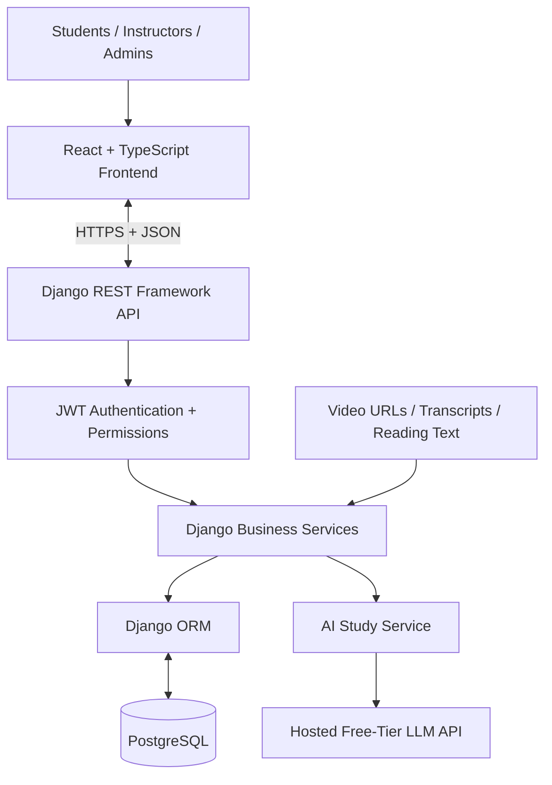
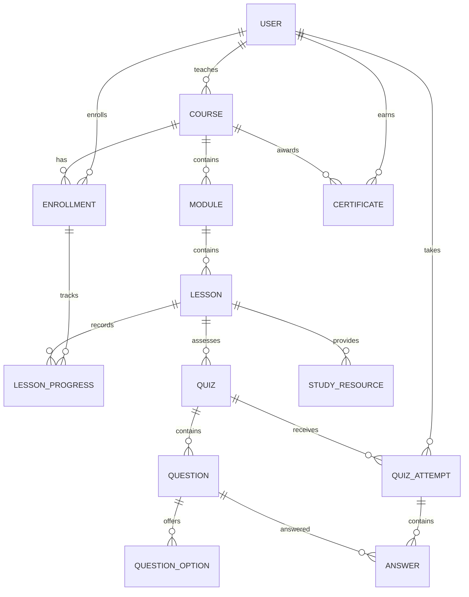
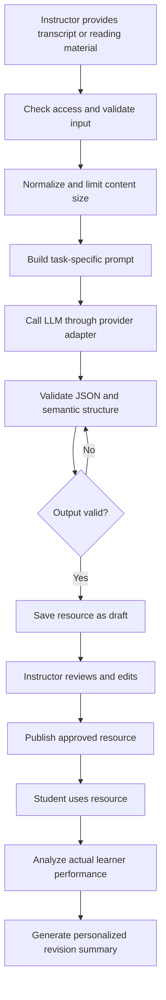

# AI-Powered Learning Management System (LMS)
## Project Architecture, Team Plan, Database Design, and Implementation Roadmap

**Project type:** Full-stack web application  
**Frontend:** React + TypeScript + Vite  
**Backend:** Python + Django + Django REST Framework  
**Database:** PostgreSQL  
**AI:** Free-tier hosted LLM API accessed through Django  
**Team:** Saanvi, Swati, Sagnik, Meheli, Bibek  

---

## 1. Project Overview

The LMS is a web application for students, instructors, and administrators. Students can enroll in courses, watch lessons, track their progress, take assessments, access AI-generated study resources, view analytics, and earn certificates. Instructors can create and manage course content, assessments, and study resources, and monitor student performance. Administrators manage accounts, course moderation, and platform-level information.

### Core learning workflow

1. An instructor creates a course and adds modules, lessons, video URLs, transcripts, and reading materials.
2. A student browses published courses and enrolls.
3. The student watches lessons and reads the accompanying materials.
4. The application saves lesson progress and playback position in PostgreSQL.
5. The student takes a quiz and receives a server-calculated result.
6. The AI layer generates quizzes, flashcards, and summaries from course material.
7. Learning history and quiz results inform personalized revision suggestions.
8. The instructor reviews student progress and course analytics.
9. The student receives a certificate after satisfying the course completion rules.

### Product principles

- PostgreSQL is the source of truth for persistent business records.
- Django owns business logic, authorization, grading, completion rules, and certificate issuance.
- AI-generated material must be validated before it is stored or published.
- Backend permissions are authoritative; hiding a frontend button is not security.
- The initial release should prioritize a complete, integrated learning workflow over optional features.
- The application must be reproducible on every team member's development machine.

---

## 2. Scope and Feature Priorities

### 2.1 MVP — required features

#### Authentication and roles
- Student registration and login.
- Logout and token refresh.
- Profile retrieval and permitted profile updates.
- Student, instructor, and admin roles.
- Role-based and object-level authorization.
- Public registration always creates a student account.

#### Course management
- Create, edit, publish, and archive courses.
- Organize courses into ordered modules and lessons.
- Store lesson video URLs, transcripts, and reading material.
- Browse published courses.
- Search and filter by title, category, or difficulty.
- View course details and enroll.
- Prevent duplicate enrollments.

#### Learning workspace
- Video player and lesson navigation.
- Module and lesson sidebar.
- Transcript and reading material display.
- Save playback position and completion state.
- Resume from the latest saved position.
- Show course and lesson progress.
- Previous/next lesson navigation.

#### Assessments
- Instructor quiz creation and editing.
- Multiple-choice questions with options, correct answers, explanations, and marks.
- Quiz time limit and passing threshold.
- Start and submit attempts.
- Server-side grading.
- Attempt history and result review.
- Configurable retake policy.
- Protect correct answers until submission.

#### AI study centre
- Generate MCQs from course transcripts and reading materials.
- Generate flashcards.
- Generate concise study summaries.
- Generate personalized revision summaries using real learner performance.
- Allow instructor review/editing of AI-generated quiz content before publication.
- Validate generated output and handle provider failures.

#### Analytics
- Student course progress and completion.
- Lessons completed.
- Quiz scores and average performance.
- Recent learning activity.
- Instructor enrollment and completion statistics.
- Instructor quiz-performance statistics for owned courses.
- Basic administrator platform statistics.

#### Certificates
- Define explicit completion criteria.
- Issue certificates only when criteria are satisfied.
- Generate a unique verification code.
- Display earned certificates.
- Provide a public verification endpoint with limited information.

### 2.2 Optional features — only after the MVP
- Course reviews and ratings.
- Bookmarked lessons.
- Discussion threads.
- Email notifications.
- Downloadable analytics reports.
- Adaptive quizzes.
- AI question answering across course content.

### 2.3 Explicitly excluded from the initial version
- Redis.
- Celery or distributed task queues.
- Microservices.
- Kubernetes.
- Payments.
- Live video conferencing.
- Custom-trained AI models.
- Custom video streaming infrastructure.

---

## 3. Technology Stack

| Layer | Technology | Responsibility |
|---|---|---|
| Frontend | React + TypeScript + Vite | Pages, forms, dashboards, interactions |
| Styling | Tailwind CSS | Responsive styling and layout |
| UI components | shadcn/ui or another agreed component library | Shared buttons, dialogs, tables, forms |
| Routing | React Router | Public and role-specific routes |
| API state | TanStack Query | Requests, loading/error states, invalidation |
| Charts | Recharts | Student and instructor analytics |
| Backend | Django | Models, business logic, transactions |
| API | Django REST Framework | REST endpoints and serializers |
| Authentication | JWT-compatible DRF authentication | Access and refresh tokens |
| Database | PostgreSQL | Persistent application records |
| ORM | Django ORM | Queries, constraints, migrations |
| AI | Hosted free-tier LLM API | Generate study resources |
| HTTP client | Python HTTP client, such as `httpx` | Backend-to-provider calls |
| Backend tests | Django tests or pytest | API, model, and service testing |
| Frontend tests | Vitest + React Testing Library | UI and component testing |
| Version control | Git + GitHub | Collaboration and code review |
| Local environment | Python virtual environment and Node.js | Development setup |
| Optional local services | Docker Compose | Consistent PostgreSQL setup if desired |

### Architecture decisions
- One Django backend, not microservices.
- One PostgreSQL database.
- React communicates with Django through REST APIs.
- React must never connect directly to PostgreSQL.
- React must never call the AI provider directly.
- AI provider credentials remain on the backend.
- Redis is not part of this project.

---

## 4. System Architecture



### Backend request flow
1. The frontend sends an HTTP request to a versioned API endpoint.
2. Django REST Framework authenticates the user.
3. Permission checks verify role, ownership, and access to the requested object.
4. A serializer validates request data.
5. A view calls the relevant service for business operations.
6. The service reads or writes through the Django ORM.
7. Django returns a consistent JSON response and HTTP status code.

### Backend organization principles
- **Models:** entities, relationships, database constraints.
- **Serializers:** request validation and response representation.
- **Views:** HTTP request/response handling.
- **Permissions:** role and object-level access rules.
- **Services:** meaningful business logic, such as grading and certificate issuance.
- **Tests:** critical behaviour, security, validation, and edge cases.
- Do not introduce extra abstraction layers for trivial CRUD operations.

### API conventions
- Prefix all API endpoints with `/api/v1/`.
- Use JSON request and response bodies.
- Use ISO 8601 timestamps in UTC.
- Use `401` for missing or invalid authentication and `403` for insufficient permissions.
- Use `400` for validation failures and `404` for missing or intentionally inaccessible objects.
- Paginate course lists, attempts, and student lists.
- Return useful error messages without exposing stack traces or secrets.

---

## 5. User Roles and Permissions

### Student
- Register and authenticate.
- Browse published courses and enroll.
- Access lessons in enrolled courses.
- Save and resume lesson progress.
- Take quizzes and view submitted results.
- Access authorized study resources.
- View personal analytics and certificates.

### Instructor
- Create, edit, publish, and archive owned courses.
- Manage modules, lessons, transcripts, video URLs, and reading material.
- Create and manage quizzes.
- Generate, edit, and publish AI resources.
- View analytics for owned courses and enrolled students.

### Administrator
- Manage user accounts and roles.
- Moderate courses and content.
- View platform-level counts and activity.
- Use authorized administrative functionality.

**Security rule:** Public registration must never allow users to choose the `ADMIN` role. Instructor/admin accounts should be created or promoted through an authorized mechanism. Django superuser access is separate from normal instructor access.

---

## 6. Database Architecture

Use Django's ORM and migrations. Configure a custom user model and `AUTH_USER_MODEL` before the first database migration.

### 6.1 Main entities

| Entity | Important fields | Purpose |
|---|---|---|
| `User` | `id`, `name`, `email`, password hash, `role`, `created_at` | Identity and role |
| `Course` | `id`, `instructor_id`, `title`, `description`, `category`, `difficulty`, `thumbnail_url`, `status`, `created_at` | Course catalogue and ownership |
| `Module` | `id`, `course_id`, `title`, `description`, `position` | Ordered course sections |
| `Lesson` | `id`, `module_id`, `title`, `description`, `video_url`, `transcript`, `reading_content`, `position`, `is_required` | Learning content |
| `Enrollment` | `id`, `student_id`, `course_id`, `enrolled_at`, `status` | Student-course relationship |
| `LessonProgress` | `id`, `enrollment_id`, `lesson_id`, `last_position_seconds`, `completed`, `updated_at` | Playback and completion |
| `Quiz` | `id`, `lesson_id` or `course_id`, `title`, `description`, `time_limit_seconds`, `pass_percentage`, `status` | Assessment configuration |
| `Question` | `id`, `quiz_id`, `prompt`, `question_type`, `marks`, `explanation`, `position` | Assessment question |
| `QuestionOption` | `id`, `question_id`, `text`, `is_correct`, `position` | Multiple-choice option |
| `QuizAttempt` | `id`, `quiz_id`, `student_id`, `started_at`, `deadline_at`, `submitted_at`, `score`, `status` | Durable attempt record |
| `Answer` | `id`, `attempt_id`, `question_id`, `selected_option_id`, `is_correct`, `marks_awarded` | Student answer and grade |
| `StudyResource` | `id`, `lesson_id`, `created_by_id`, `resource_type`, `content`, `status`, `created_at` | AI-generated or reviewed resource |
| `Certificate` | `id`, `student_id`, `course_id`, `verification_code`, `issued_at` | Course credential |
| `AuditLog` (optional) | actor, action, target, timestamp | Important administrative actions |

Choose one consistent approach for course-level versus lesson-level quizzes before implementing the schema. If both are required, model the relationship explicitly and validate it.

### 6.2 Entity relationships



### 6.3 Database integrity requirements
1. Email addresses are unique.
2. A student can enroll in a course only once.
3. One progress record exists per enrollment and lesson.
4. One answer exists per attempt and question.
5. Certificate verification codes are unique.
6. Modules and lessons have deterministic ordering.
7. An answer must reference a question belonging to the attempt's quiz.
8. An instructor can edit only owned courses unless an authorized administrator intervenes.
9. Critical submission and certificate operations use database transactions where appropriate.
10. Submitted attempts preserve their scoring outcome even if a quiz is edited later.

Use database constraints for uniqueness and relationships, plus service validation for rules involving multiple related objects. Avoid hard-deleting courses and questions that are needed to explain historical results.

---

## 7. Redis-Free Implementation of Progress, Quizzes, and Leaderboards

### Video progress
- Store playback position and completion state in PostgreSQL.
- Save progress approximately every 10–15 seconds during playback, and on pause/page exit when possible.
- Restore the latest persisted position on reopening a lesson.
- Validate user access and playback position on the backend.
- Never trust a client-supplied overall completion percentage.

### Quiz sessions
- Persist attempt start time, deadline, status, submitted time, answers, and score in PostgreSQL.
- Validate the deadline on the server for every relevant operation.
- Use transactions to prevent duplicate grading or submissions.
- Treat the database deadline as authoritative; a frontend timer is only a display.

### Leaderboards
- Query PostgreSQL for ranking results.
- Define the ranking rule explicitly, such as best score per student or total points.
- Add indexes to support frequent queries if needed.
- Do not add caching until real performance measurements justify it.

---

## 8. API Contract

All routes use `/api/v1/`. The following routes are planned contracts; the implementation should document request and response schemas.

### 8.1 Authentication

| Method | Endpoint | Purpose |
|---|---|---|
| POST | `/auth/register/` | Create student account |
| POST | `/auth/login/` | Authenticate and return tokens |
| POST | `/auth/refresh/` | Refresh access token |
| POST | `/auth/logout/` | Log out and invalidate refresh credentials where supported |
| GET | `/auth/me/` | Current profile and role |
| PATCH | `/auth/me/` | Update permitted profile fields |

### 8.2 Courses and enrollments

| Method | Endpoint | Purpose |
|---|---|---|
| GET | `/courses/` | Browse published courses |
| GET | `/courses/{id}/` | Course details |
| POST | `/courses/` | Create a course |
| PATCH | `/courses/{id}/` | Update an owned course |
| POST | `/courses/{id}/publish/` | Publish course |
| GET | `/courses/{id}/modules/` | Ordered modules and lessons |
| POST | `/courses/{id}/enroll/` | Enroll current student |
| GET | `/enrollments/me/` | Current student's enrollments |
| GET | `/courses/{id}/students/` | Enrolled students for authorized instructor |

### 8.3 Lessons and progress

| Method | Endpoint | Purpose |
|---|---|---|
| GET | `/lessons/{id}/` | Retrieve authorized lesson |
| GET | `/lessons/{id}/progress/` | Retrieve saved progress |
| PATCH | `/lessons/{id}/progress/` | Update playback position |
| POST | `/lessons/{id}/complete/` | Mark lesson complete |
| GET | `/courses/{id}/progress/` | Course progress |

Example request:

```json
{
  "last_position_seconds": 245
}
```

### 8.4 Assessments

| Method | Endpoint | Purpose |
|---|---|---|
| GET | `/quizzes/{id}/` | Quiz instructions and permitted question data |
| POST | `/quizzes/{id}/start/` | Start attempt |
| GET | `/attempts/{id}/` | Current attempt state |
| PUT | `/attempts/{id}/answers/` | Save answers |
| POST | `/attempts/{id}/submit/` | Submit and grade |
| GET | `/quizzes/{id}/results/me/` | Student attempt history |
| GET | `/quizzes/{id}/leaderboard/` | Ranking if enabled |

Never return correct answers before submission. Submission responses may include score, maximum marks, percentage, pass/fail status, and permitted feedback.

### 8.5 AI study resources

| Method | Endpoint | Purpose |
|---|---|---|
| POST | `/lessons/{id}/ai/generate/` | Generate a resource |
| GET | `/ai/jobs/{id}/` | Retrieve generation status if job-style responses are used |
| GET | `/lessons/{id}/resources/` | List authorized resources |
| GET | `/resources/{id}/` | Retrieve resource |
| PATCH | `/resources/{id}/` | Edit authorized draft |
| POST | `/resources/{id}/publish/` | Publish approved resource |

For the first implementation, generation may be synchronous with a strict timeout. If provider response times make this unreliable, introduce a background-job mechanism later without changing the user-facing resource contract unnecessarily.

### 8.6 Analytics and certificates

| Method | Endpoint | Purpose |
|---|---|---|
| GET | `/analytics/student/` | Student statistics |
| GET | `/courses/{id}/analytics/` | Owned-course analytics |
| GET | `/analytics/admin/` | Platform statistics |
| GET | `/certificates/me/` | Student certificates |
| GET | `/certificates/verify/{code}/` | Public verification |

---

## 9. AI Integration Design

### Provider selection
Start by evaluating a free-tier hosted LLM API, such as the Gemini Developer API. Confirm current model availability, quota, rate limits, and data-use terms before committing. Keep the provider replaceable.

### AI processing flow



### Resource types
1. **MCQs:** question prompt, options, correct option index, explanation.
2. **Flashcards:** front and back text.
3. **Summaries:** title, key points, revision topics.
4. **Personalized revision summaries:** generated using actual attempt scores and weak-topic information.

### Example MCQ response schema

```json
{
  "title": "Introduction to Networking",
  "questions": [
    {
      "prompt": "Which layer is responsible for routing?",
      "options": ["Application", "Transport", "Network", "Physical"],
      "correct_option_index": 2,
      "explanation": "The network layer performs routing."
    }
  ]
}
```

### AI security and reliability
- Call the provider only from Django.
- Keep API credentials in environment variables.
- Never commit real credentials.
- Validate JSON, option counts, answer indexes, content length, and required fields.
- Retry only a limited number of times for suitable failures.
- Handle timeouts, rate limits, invalid output, and quota exhaustion.
- Do not send passwords, tokens, or unnecessary personal information.
- Treat course content as untrusted data, not as instructions to override system behaviour.
- Mock provider calls in tests to avoid consuming quota.
- Apply per-user rate limits and sensible input/output caps.
- Do not claim that generated content is factually perfect; allow instructor review before publishing assessments.

### Suggested AI app structure

```text
apps/ai_study/
├── models.py
├── serializers.py
├── urls.py
├── views.py
├── services.py
├── providers/
│   ├── base.py
│   └── selected_provider.py
├── prompts/
│   ├── quiz.py
│   ├── flashcards.py
│   └── summary.py
├── validators.py
└── tests.py
```

---

## 10. Frontend Architecture

Organize the frontend by feature, with shared components and one typed API client.

```text
frontend/
└── src/
    ├── app/
    │   ├── router.tsx
    │   └── providers.tsx
    ├── components/
    │   ├── ui/
    │   └── shared/
    ├── features/
    │   ├── auth/
    │   ├── courses/
    │   ├── enrollments/
    │   ├── learning/
    │   ├── quizzes/
    │   ├── analytics/
    │   ├── ai-study/
    │   └── certificates/
    ├── layouts/
    ├── lib/
    │   └── api.ts
    ├── types/
    └── main.tsx
```

A typical feature may contain:
- `api.ts` — API functions.
- `types.ts` — TypeScript interfaces.
- `hooks.ts` — TanStack Query hooks.
- `components/` — reusable feature components.
- `pages/` — route-level pages.

### Required UI states
Every data-driven page should handle:
- Loading.
- Empty results.
- Successful results.
- API errors.
- Validation errors.
- Unauthorized access.
- AI generation in progress and failure.

Do not hardcode quiz scores, progress percentages, analytics, or certificate data in production UI.

---

## 11. Backend Folder Structure

```text
backend/
├── config/
│   ├── settings.py
│   ├── urls.py
│   ├── asgi.py
│   └── wsgi.py
├── apps/
│   ├── accounts/
│   ├── courses/
│   ├── enrollments/
│   ├── progress/
│   ├── assessments/
│   ├── analytics/
│   ├── ai_study/
│   └── certificates/
├── common/
├── manage.py
└── requirements.txt
```

A Django app can contain `models.py`, `serializers.py`, `views.py`, `urls.py`, `permissions.py`, `services.py`, and `tests.py` as needed. Do not create unused boilerplate files just to match the structure.

---

## 12. Team Work Allocation

### Saanvi — Frontend: Student Experience

**Ownership**
- Landing page and course catalogue.
- Course details and enrollment UI.
- Student dashboard and enrolled courses.
- Learning workspace and video player.
- Lesson/module navigation.
- Progress display and lesson completion.
- Student profile and course progress views.

**Key components**
- `CourseCard`, `CourseGrid`, `CourseFilters`
- `CourseDetails`, `EnrollmentButton`
- `StudentDashboard`, `EnrolledCourseCard`
- `VideoPlayer`, `LessonSidebar`, `LessonNavigation`
- `ProgressBar`, `LessonCompletionButton`

**API integration**
- Course list and details.
- Enrollment and current enrollments.
- Lesson content and progress.
- Student profile and analytics.

**Acceptance criteria**
- Students can browse and enroll.
- Enrolled courses appear on the dashboard.
- Lesson navigation works.
- Progress is restored from the backend.
- UI values reflect API data, not hardcoded placeholders.

### Swati — Frontend: Instructor, Assessments, and AI UI

**Ownership**
- Coordinate shared registration/login components with Saanvi.
- Instructor dashboard.
- Course create/edit forms.
- Module and lesson editor.
- Quiz builder and question editor.
- Quiz-taking and results UI.
- AI study centre, flashcards, and summaries.
- Instructor analytics charts.
- Certificate list and display.

**Key components**
- `AuthForm`, `CourseEditor`, `ModuleEditor`, `LessonEditor`
- `QuizBuilder`, `QuestionEditor`, `QuizPlayer`, `QuizResult`
- `AIResourceGenerator`, `FlashcardViewer`, `SummaryViewer`
- `AnalyticsCharts`, `CertificateCard`

**API integration**
- Course and lesson authoring.
- Quiz CRUD, attempts, submission and results.
- AI generation and study-resource retrieval.
- Instructor analytics and certificates.

**Acceptance criteria**
- Instructors can manage course content.
- Students can take quizzes and view real results.
- AI screens handle loading and provider errors.
- Analytics use actual API data.
- Forms display validation feedback.

### Sagnik — Backend: Accounts, Courses, and Enrollments

**Django apps**
- `accounts`
- `courses`
- `enrollments`

**Ownership**
- Django REST Framework and JWT configuration.
- Custom user model and role management.
- Registration, login, refresh, logout and profile endpoints.
- Course, module and lesson models.
- Course ownership and object-level permissions.
- Draft, published, and archived states.
- Search, filtering, and pagination.
- Enrollment and duplicate-enrollment prevention.
- Django Admin configuration.
- Authentication, permission and course tests.

**Acceptance criteria**
- Authentication works with PostgreSQL.
- Role restrictions are enforced on the backend.
- Instructors cannot edit other instructors' courses.
- Students can browse published courses and enroll once.
- Migrations and relevant tests pass.

### Meheli — Backend: Progress, Assessments, Analytics, Certificates

**Django apps**
- `progress`
- `assessments`
- `analytics`
- `certificates`

**Ownership**
- Lesson progress and playback persistence.
- Course progress calculation.
- Quiz, question and option models.
- Attempt creation, deadlines and submission.
- Server-side grading and answer validation.
- Attempt history and permitted feedback.
- Retake policy.
- PostgreSQL leaderboard queries.
- Student/instructor analytics.
- Course completion and certificate issuance.
- Tests for scoring, access control, deadlines and completion.

**Coordination**
- Agree on shared Course, Lesson, and Enrollment fields with Sagnik.
- Agree on quiz schemas with Bibek so generated questions can become regular quiz records.
- Publish stable API response contracts for both frontend owners.

**Acceptance criteria**
- Progress survives browser restarts.
- Grades are calculated only by the server.
- Expired and duplicate submissions are handled safely.
- Analytics use persisted records.
- Certificates require completion eligibility.

### Bibek — Backend: AI and Integration

**Django app**
- `ai_study`

**AI ownership**
- Evaluate free-tier LLM providers and choose one with available quota.
- Implement provider adapter and central AI client.
- Configure provider credentials through environment variables.
- Process transcripts and reading material.
- Generate MCQs, flashcards, and summaries.
- Validate generated structures and content.
- Store study resources and publication status.
- Implement personalized revision using actual learner performance.
- Handle provider errors, timeouts, rate limits and quota exhaustion.
- Write tests using mocked provider responses.

**Platform/integration ownership**
- Coordinate root Django configuration and URL registration.
- Maintain `.env.example`.
- Coordinate shared models and migrations.
- Configure CORS and local development settings.
- Resolve cross-module integration issues.
- Maintain master README and run instructions.
- Coordinate final end-to-end verification.

**Acceptance criteria**
- AI resources are based on supplied course content.
- Malformed output is rejected or retried within defined limits.
- API keys never appear in frontend code or Git.
- AI quizzes can be converted into normal editable quiz records.
- The integrated application starts using documented instructions.

### Ownership summary

| Person | Main responsibility | Deliverable |
|---|---|---|
| Saanvi | Student frontend | Student learning workflow |
| Swati | Instructor, assessment and AI frontend | Authoring tools, quizzes, study centre and charts |
| Sagnik | Backend foundation | Authentication, courses and enrollments |
| Meheli | Learning/assessment backend | Progress, grading, analytics and certificates |
| Bibek | AI backend and integration | AI pipeline, shared configuration and integrated release |


---

## 13. Shared Model Ownership

| Entity                         | Collaborators                |
| ------------------------------ | ---------------------------- |
| User                           | Bibek                        |
| Course, Module, Lesson         | Saanvi, Swati, Meheli, Bibek |
| Enrollment                     | Saanvi, Meheli               |
| LessonProgress                 | Saanvi                       |
| Quiz, Question, QuestionOption | Swati, Bibek                 |
| QuizAttempt, Answer            | Swati, Bibek                 |
| StudyResource                  | Swati                        |
| Certificate                    | Saanvi, Swati                |


---

## 14. Git and Collaboration Workflow

### Branches
Use `main` as the stable branch and `develop` as the shared integration branch. Create feature branches from `develop`.

Examples:
- `feature/saanvi-student-dashboard`
- `feature/swati-quiz-builder`
- `feature/sagnik-course-api`
- `feature/meheli-quiz-engine`
- `feature/bibek-ai-study`

### Collaboration rules
1. Agree on database fields and API contracts before implementing dependent modules.
2. Each owner writes tests for their feature.
3. Use pull requests and review changes before merging.
4. Never overwrite another teammate's work to resolve a conflict.
5. Commit migrations with the relevant model changes.
6. Coordinate migrations involving shared models.
7. Never commit `.env`, credentials, tokens, or passwords.
8. Do not merge changes that break startup or existing tests.
9. Keep setup instructions and the API contract updated.
10. Reuse shared TypeScript types and UI components rather than duplicating them.

---

## 15. Implementation Roadmap

### Milestone 1 — Foundation
**Owners:** All five
- Set up React and Django projects.
- Configure PostgreSQL and environment variables.
- Create the custom user model before the first migration.
- Establish shared API conventions and documentation.
- Add a health endpoint and confirm the application starts.

### Milestone 2 — Authentication and course management
**Owners:** Sagnik, Saanvi, Swati

- Implement authentication and permissions.
- Implement course/module/lesson models and APIs.
- Build login, registration, catalogue, enrollment and instructor editor screens.
- Verify end-to-end course creation and enrollment.

### Milestone 3 — Learning and assessments
**Owners:** Meheli, Saanvi, Swati

- Implement lesson progress.
- Build video learning workspace.
- Implement quiz models, attempts and grading.
- Build quiz-taking and results UI.
- Test authorization and persisted state.

### Milestone 4 — AI study centre
**Owners:** Bibek

- Select and configure a free-tier provider.
- Implement provider adapter, prompts and validators.
- Persist generated study resources.
- Build generation, review and study UI.
- Test failures with mocked provider responses.

### Milestone 5 — Analytics and certificates
**Owners:** Meheli, Saanvi, Swati

- Implement student and instructor analytics.
- Define completion rules.
- Implement certificate issuance and verification.
- Connect dashboards to real API responses.

### Milestone 6 — Integration and release

- Test end-to-end journeys and permissions.
- Fix critical defects.
- Seed demo courses and accounts safely.
- Verify clean-machine setup instructions.
- Complete README and demonstration preparation.

A 10-day timeline is possible only with tightly controlled scope and early integration. If the deadline permits, allow more time for testing and UI polish.

---

## 16. Testing Strategy

### Backend tests
- Registration, login, role assignment and permissions.
- Course ownership and publication.
- Duplicate enrollment prevention.
- Lesson progress persistence and access control.
- Quiz scoring and answer validation.
- Deadline enforcement and duplicate submissions.
- AI output validation and provider failures.
- Analytics aggregation.
- Certificate eligibility and unique codes.

### Frontend tests
- Authentication form validation.
- Role-specific navigation.
- Course catalogue and enrollment interactions.
- Progress loading and error states.
- Quiz answer selection and submission states.
- AI generation loading/error/success states.
- Analytics rendering from mock API data.

### Manual end-to-end acceptance checks
- A student registers, enrolls, watches a lesson, leaves and resumes.
- An instructor creates a course and quiz.
- A student submits a quiz and sees a server-generated score.
- AI generates and validates a study resource from a transcript.
- Instructor analytics reflect student activity.
- An eligible student receives a verifiable certificate.
- A student cannot access another student's private data.
- An instructor cannot edit a course they do not own.

---

## 17. Definition of Done

The MVP is complete when:

- [ ] Student registration and login work.
- [ ] Instructors can create, edit and publish courses.
- [ ] Students can browse and enroll.
- [ ] Authorized students can access lessons.
- [ ] Playback progress is persisted and restored.
- [ ] Instructors can create quizzes.
- [ ] Students can submit quizzes and receive server-calculated scores.
- [ ] Attempts and answers persist in PostgreSQL.
- [ ] AI generates valid MCQs, flashcards and summaries from course content.
- [ ] AI resources can be reviewed and edited before publication.
- [ ] Personalized revision uses actual performance data.
- [ ] Dashboards show database-derived analytics.
- [ ] Certificates follow explicit completion criteria.
- [ ] Backend access controls prevent cross-user data access.
- [ ] Tests cover critical business rules.
- [ ] The project can be run from the README on a clean machine.

---

## 18. Master Project Rules for Coding Agents

1. Inspect the existing repository before changing files.
2. Follow this architecture and the agreed API contract.
3. Implement one coherent feature at a time.
4. Do not invent conflicting model fields or duplicate endpoints.
5. Do not overwrite unrelated teammate changes.
6. Include migrations and tests with backend model changes.
7. Run relevant tests and report failures honestly.
8. Never claim an unimplemented or unverified feature works.
9. Update documentation when APIs, configuration or setup instructions change.
10. If a shared contract is missing, propose the change and identify affected modules before implementing it.
11. Keep credentials in environment variables and provide `.env.example`.
12. Prefer simple, maintainable solutions over unnecessary dependencies or abstractions.

## Final Goal

Deliver one integrated LMS in which authentication, courses, enrollment, video progress, assessments, AI-generated study resources, analytics, and certificates work together end to end. Prioritize correctness, security, maintainability, and a reliable demonstration over unnecessary complexity.